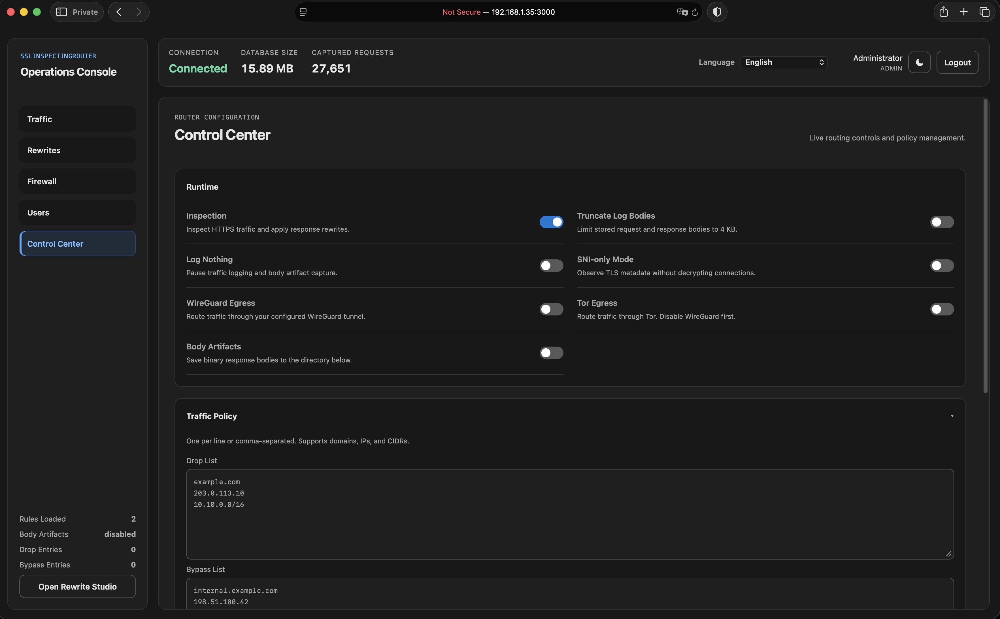
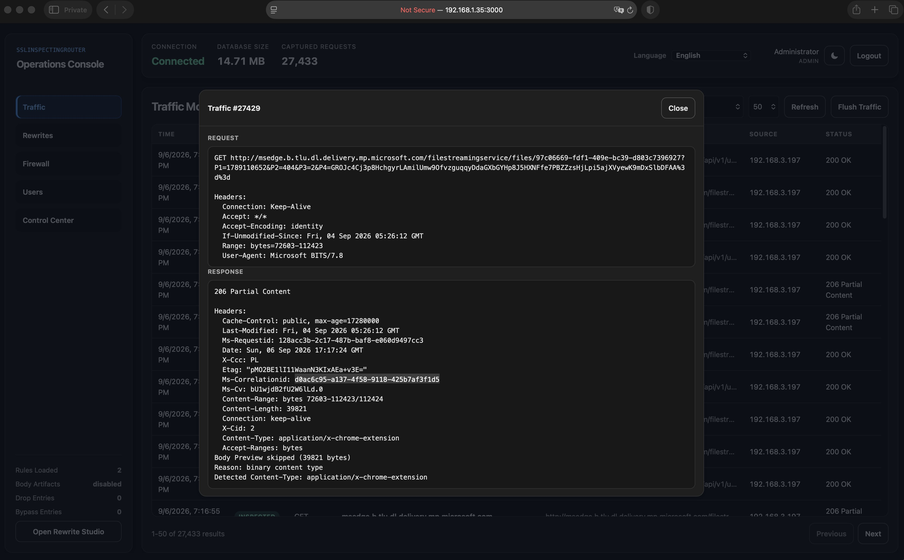
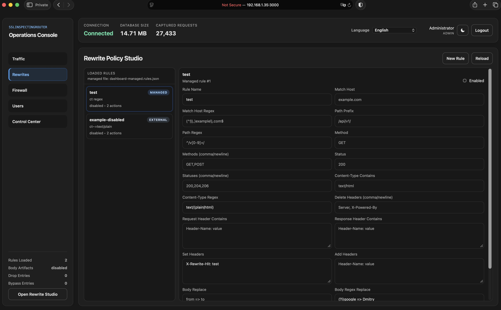
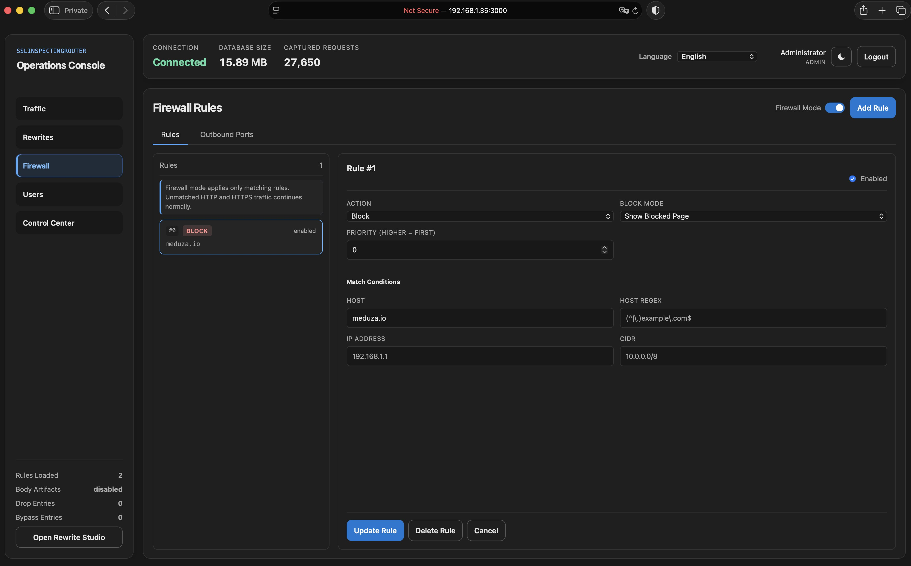
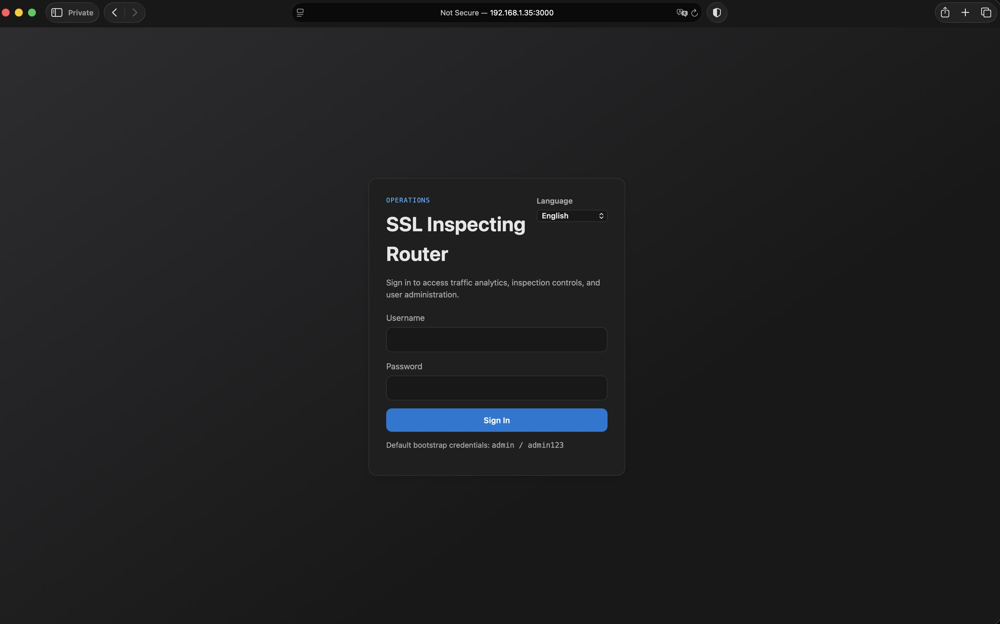

[](go.mod)
[](LICENSE)
[](documentation/troubleshooting.md)
[](https://github.com/dmitryporotnikov/SSLInspectingRouter/actions/workflows/release.yml)

SSLInspectingRouter is a Go proxy for Linux that pulls HTTP and HTTPS traffic off the wire. Put it on a box in the traffic path, and iptables NAT hands it the connections. From there it decrypts and logs them, rewrites the responses, or just watches the TLS handshakes go past.

Clients need no proxy settings and no PAC file. Name an interface, and traffic arrives.

This is a debugging and lab tool. It intercepts TLS by default, so run it on networks you own or have permission to test.

## Dashboard

One console for live traffic, rewrite rules, firewall policy, and the runtime switches.

[](screenshots/control-center.jpg)

<details>
<summary>Traffic details, rewrite studio, firewall rules, sign-in</summary>

|  |  |
| --- | --- |
| [](screenshots/traffic-details.jpg) | [](screenshots/rewrite-studio.jpg) |
| [](screenshots/firewall.jpg) | [](screenshots/login.jpg) |

</details>

## What it does

- Transparent interception over iptables NAT. Dual-NIC mode pins LAN ingress (`-lan`) and WAN masquerading (`-wan`).
- TLS MITM with a local CA and per-host certificates generated on the fly
- SNI-only mode forwards HTTPS untouched and logs the ClientHello: TLS version, ciphers, ALPN, extensions. No decryption.
- SQLite logging with full request and response capture, optional body artifacts on disk, and PCAP export of decrypted traffic for Wireshark
- JSON rewrite rules for response headers and bodies
- WireGuard or Tor for egress, switchable at runtime, one at a time
- Drop and bypass lists by FQDN, IP, or CIDR, plus an allowlist that limits inspection to chosen source IPs
- Firewall mode with per-host rules and an iptables-enforced outbound port allowlist (HTTPS and DNS by default)
- Web dashboard with authentication, a realtime traffic view, and toggles that don't need a restart

## Install

Grab the latest build from [releases](https://github.com/dmitryporotnikov/SSLInspectingRouter/releases). linux/amd64, rebuilt on every push to `main`, SHA256 alongside.

```bash
curl -LO https://github.com/dmitryporotnikov/SSLInspectingRouter/releases/download/latest/sslinspectingrouter-linux-amd64
chmod +x sslinspectingrouter-linux-amd64
sudo ./sslinspectingrouter-linux-amd64 -web :3000
```

Or build it yourself. Go 1.26 is what `go.mod` asks for.

```bash
sudo apt install iptables iproute2 golang

git clone https://github.com/dmitryporotnikov/SSLInspectingRouter.git
cd SSLInspectingRouter
go build -o sslinspectingrouter ./cmd/router
sudo ./sslinspectingrouter -web :3000
```

Then open `http://<router-ip>:3000`. The first login is `admin / admin123`. Change it: set `SIR_ADMIN_USER` and `SIR_ADMIN_PASS` before the first run, or use the Users page later.

`sudo ./scripts/setup.sh` does that first run for you, with dependency and root checks.

Root is required for iptables, IP forwarding, and interception. Without `-web` there's no dashboard and request logs go to the console. `-verbose` adds application-level detail.

## Before you run it

This one decrypts TLS by default. Use it on networks you control, and don't leave `admin / admin123` on a dashboard other people can reach.

`ca-cert.pem` has to be installed on the devices you want to inspect. `logs/traffic.db` and any `-pcap` file hold decrypted traffic, so handle them like what they are. The rest of the checklist is in [documentation/security.md](documentation/security.md).

## Modes

| Mode | What happens | How to enable |
| --- | --- | --- |
| Full inspection | MITM HTTPS, log every request and response, apply rewrites. | Default. |
| Bypass | Tunnel the matching hosts untouched and log a `BYPASSED` marker. | `-bypass` or dashboard policy. |
| Drop | Close the connection when something matches. | `-drop` or dashboard policy. |
| Inspection paused | Tunnel everything untouched until you switch inspection back on. | Inspection toggle in the dashboard. |
| SNI-only | Forward HTTPS unmodified, log only SNI and ClientHello metadata. | `-snionly` or the SNI-only toggle. |
| Inspect-only allowlist | Inspect traffic from the listed source IPs and bypass the rest. | `-inspectonly`. |
| Dual-NIC gateway | Intercept only traffic arriving on the LAN side, NAT out the WAN. | `-lan <iface>` and `-wan <iface>`. |
| Firewall rules | Block, bypass, or inspect individual hosts at the proxy layer. | Firewall → Rules. |
| Outbound ports | Default-DROP iptables allowlist for forwarded traffic (HTTPS and DNS remain open). | Firewall → Outbound Ports. |

Sample log row and the full metadata list: [documentation/snionly.md](documentation/snionly.md).

## Limits

IPv4 and TCP only. UDP is ignored except for DNS and, if you enable it, QUIC. Filtering by hostname needs SNI, so a TLS connection to a bare IP can only be matched by address. Non-HTTP/HTTPS traffic on port 443 doesn't survive MITM: SSH, RDP, assorted tunnels. Bypass those or use `-snionly`. Certificate generation is in the connection path, so benchmark it on a busy network before deploying.

## Contributing

Bugs and pull requests go to the [issue tracker](https://github.com/dmitryporotnikov/SSLInspectingRouter/issues). [documentation/contributing.md](documentation/contributing.md) covers the build, the tests, and what to know before you touch iptables.

## License

GPL-3.0. See [LICENSE](LICENSE).

## Credits

Localization by [@ankit20012006](https://github.com/ankit20012006) and [@Anand-240](https://github.com/Anand-240).
